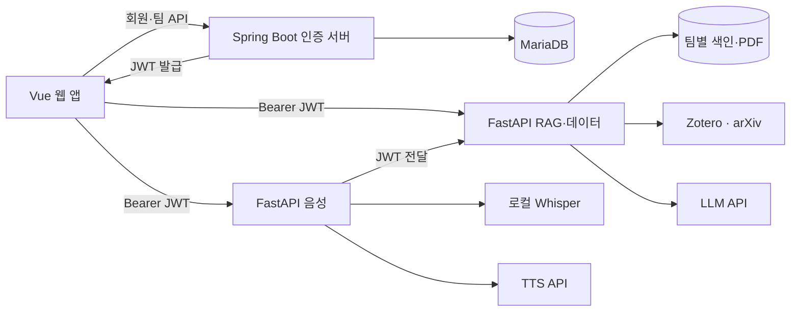

# Referoom · 레퍼룸

> 팀 논문을 검색하고, 출처와 함께 답하는 연구 어시스턴트

레퍼룸은 팀이 모은 논문을 바탕으로 개념 질의응답, 선행연구 비교, 연구 주제 제안, 원고 수치 검증을 제공하는 웹 서비스입니다. 답변에 논문·페이지 출처를 연결하고, 근거가 부족하면 논문 수집이나 원문 확인을 안내합니다.

## 주요 기능

| 기능 | 설명 |
|---|---|
| 회원·팀 관리 | JWT 로그인, 팀 생성·초대 코드 참여, 관리자 권한 관리 |
| 논문 라이브러리 | PDF 업로드, arXiv 후보 선택 수집, Zotero 동기화, 검색·필터 |
| 논문 튜터 | 팀 논문 기반 답변, 출처 확인, 더 쉽게·더 깊게 재질문 |
| 선행연구 비교 | 문제·방법·데이터셋·지표·결과·한계 정리표 |
| 연구 주제 제안 | 논문의 한계에 근거한 주제 후보와 실험 구성 제안 |
| 원고 검증 | 수치 주장과 논문 근거 대조, 판정표·비교 문장 초안 |
| 논문 요약 | 문제·아이디어·방법·결과·한계·확인 사항 요약 |
| 음성 튜터 | 마이크 질문 → STT → 논문 답변 → TTS 재생 |

질문 화면의 기본 모드는 튜터이며, 연구 모드에서 선행연구·주제·검증을 선택합니다. 출처를 누르면 원문 PDF의 해당 페이지를 확인할 수 있습니다.

## 아키텍처



브라우저는 인증 서버에서 JWT를 발급받아 RAG·음성 API를 직접 호출합니다. 인증 서버는 회원·팀 DB를 관리하며, Python 서비스는 공통 패키지로 JWT와 권한을 검증하고 팀별 데이터에 접근합니다.

## 기술 스택

| 영역 | 기술 |
|---|---|
| 프론트엔드 | Vue 3, Vite, Pinia, Vue Router, KaTeX |
| 인증 서버 | Spring Boot, Spring Security, JPA, BCrypt, JWT |
| RAG·데이터 | Python 3.11, FastAPI, LangChain, pypdf, sentence-transformers, numpy |
| 음성 | faster-whisper, FFmpeg, OpenAI TTS |
| 저장·배포 | MariaDB 11, Docker Compose, nginx |

기본 모델은 답변 생성 `gpt-4o, gpt-6-luna`, 임베딩 `BAAI/bge-m3`, STT `small`, TTS `tts-1`·`nova`입니다. `gpt-6-luna`는 평가용 판정 모델로 설정되어 있습니다.

## 프로젝트 구조

```text
referoom/
├── frontend/           # 웹 화면·상태·API 클라이언트
├── auth-server/        # 회원·팀 관리·JWT 발급
├── common-py/          # 공통 인증·권한·오류·로그
├── rag-service/        # 논문 수집·검색·RAG·연구 모드
├── voice-service/      # STT·TTS·음성 튜터
├── db/                 # 회원·팀 스키마
├── data/               # 시드 데이터
├── eval/               # 평가셋·평가 도구·결과
├── scripts/            # 개발 실행·E2E·운영 집계
└── docker-compose.yml  # 통합 실행
```

## 설치·실행

Docker와 Docker Compose를 준비하고 프로젝트 루트에서 실행합니다.

```bash
test -f .env || cp .env.example .env
```

`.env`에 다음 값을 입력합니다.

| 변수 | 용도 |
|---|---|
| `JWT_SECRET` | 인증·RAG·음성이 공유하는 JWT 키 |
| `DB_PASSWORD` | MariaDB 비밀번호 |
| `OPENAI_API_KEY` | 답변 생성·음성 합성 API 키 |
| `ZOTERO_GROUP_ID` | 논문 라이브러리 그룹 ID |
| `ZOTERO_API_KEY` | 그룹 읽기·쓰기·파일 접근 키 |
| `ZOTERO_TEAM_ID` | 라이브러리를 연결할 팀 ID |

```bash
docker compose up -d --build
docker compose ps
```

| 서비스 | 접속 주소 |
|---|---|
| 웹 | http://localhost:5174 |
| 인증 API 문서 | http://localhost:8080/swagger-ui/index.html |
| RAG API 문서 | http://localhost:8001/docs |
| 음성 API 문서 | http://localhost:8008/docs |

첫 실행에는 임베딩·음성 모델 다운로드와 로딩 시간이 필요합니다. 회원가입 후 팀을 생성하거나 참여하고, 해당 팀 ID를 `ZOTERO_TEAM_ID`에 설정합니다. 값을 변경하면 `docker compose up -d rag`로 RAG 서비스에 반영합니다.

```bash
# 로그 확인
docker compose logs --tail=100 auth rag voice

# 종료: 데이터 볼륨 유지
docker compose down
```

호스트 개발 실행에는 Python 3.11, Node.js·npm, JDK 21, FFmpeg와 MariaDB가 필요합니다. DB 접속 정보를 설정하고 스키마를 준비한 뒤 개발 관리 스크립트를 사용합니다.

```bash
bash scripts/dev.sh setup
bash scripts/dev.sh up auth rag voice frontend
bash scripts/dev.sh status
```

## 팀원별 기여

| 팀원 | 담당 영역 | 주요 기여 |
|---|---|---|
| 김재욱 | 데이터 파이프라인 | arXiv 검색·후보 조회, Zotero 저장, PDF 파서 초기 구현 |
| 임예리 | 데이터·RAG·프론트엔드 | 라이브러리 API·로컬 색인, 근거 기반 답변·연구 모드·요약, 평가셋, 인증 연동, 연구 모드 화면·결과 컴포넌트 |
| 김영준 | 인증·공통 API·DB | 회원·팀·JWT, 공통 인증·권한·오류·로그, DB, 운영·비용 리포트 |
| 김상현 | 프론트엔드 | 초기 Vue 화면, mock API, 원문 PDF 뷰어 |
| 황민진 | 음성 서비스 | STT·TTS, 음성 튜터 `/voice-qa` |
